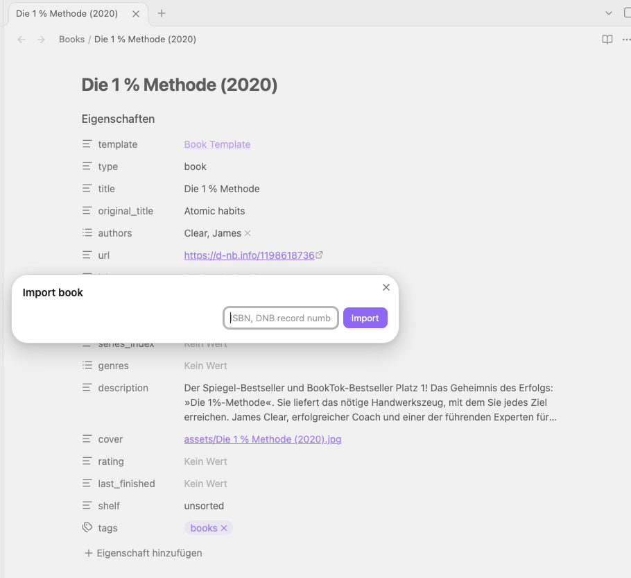

# Pinpoint Media Notes

[](https://github.com/sercxanto/pinpoint-media-notes/actions/workflows/ci.yml)
[](LICENSE)

An Obsidian plugin that turns an ISBN or a TMDB link into a finished note for
a book, movie or series, with cover image and complete properties.



## Why

Tracking what you read and watch in Obsidian works best when every note
looks the same: the same properties, the same values, a cover image in the
vault. Bases then turn the notes into a library you can sort and filter.
Typing all of that by hand is tedious, and plugins that search by title
regularly pick the wrong edition, the wrong year or the remake.

Pinpoint Media Notes starts from an **exact identifier** instead:

- the **ISBN** printed in the book in your hands names exactly one edition:
  the paperback, the e-book or the audiobook;
- a **TMDB link**, copied after picking the movie on
  [themoviedb.org](https://www.themoviedb.org) by poster, year and plot,
  names exactly one film or series.

The plugin fetches the rest from the catalogue and writes the note. There is
nothing to search, so nothing to pick wrongly.

## What you get

- **Books, e-books and audiobooks** from the catalogue of the Deutsche
  Nationalbibliothek (DNB); an ISBN the DNB does not know, such as most
  English-language editions, comes from the Library of Congress and Open
  Library. No account needed.
- **Movies and series** from TMDB, with title, genres and description in the
  language you choose.
- **A local copy of the cover or poster** for every note, so the note still
  shows it offline and in ten years.
- **A fixed property schema**, ready for Bases and Dataview: numbers as
  numbers, lists as lists, every note with the same properties.
- **Nothing overwritten:** an existing note is never touched; a name clash is
  reported instead.
- Desktop and mobile; in daily use on iOS.

A book note right after the import:

```yaml
---
template: "[[Book Template]]"
type: book
title: Die 1 % Methode
original_title: Atomic habits
authors:
  - Clear, James
url: https://d-nb.info/1198618736
isbn: "9783442178582"
year: 2020
series:
series_index:
genres: []
description: Das Standardwerk über Gewohnheiten. Wer seine Gewohnheiten ändert, ändert sein Leben.
cover: "[[assets/Die 1 % Methode (2020).jpg]]"
rating:
last_finished:
shelf: unsorted
tags:
  - books
---
## Notes
```

`rating`, `last_finished` and `shelf` are yours to fill in later; `shelf:
unsorted` marks the note as not yet reviewed.

## Opinionated by design

The plugin is built for one vault and its data model, described in
[`docs/schema/`](docs/schema/): the properties, their values and the file
names are fixed, not configurable. If that model suits you, use it; the
schema notes can be copied into your vault as they are. If not, a fork is
the better starting point. The plugin is not in the community plugin list
and is not meant to be.

## Quick start

1. **Install** by hand (Obsidian 1.13 or later): build with `npm install` and
   `npm run build`, copy it into your vault with
   `scripts/install-to-vault.sh <path to vault>`, then enable **Pinpoint
   Media Notes** under **Settings → Community plugins**.
2. **Configure:** set a folder for book notes and, for movies, one for movie
   and series notes, your TMDB **API Read Access Token** (free account) and
   your language, for example `de-DE`.
3. **Import:** run **Import book** or **Import movie or series** from the
   command palette and paste an ISBN or a TMDB link. The new note opens.

The [user guide](docs/USER_GUIDE.md) covers every setting, accepted input,
property and message in detail.

## Network use and privacy

The plugin sends requests only when you import an entry, and only to these
services:

| Host                              | For                                                     | Receives                          |
| --------------------------------- | ------------------------------------------------------- | --------------------------------- |
| `services.dnb.de`                 | catalogue lookup and blurbs (DNB, no account)           | ISBN or record number             |
| `portal.dnb.de`                   | book covers (DNB)                                       | ISBN                              |
| `id.loc.gov`                      | catalogue lookup at the Library of Congress, no account | ISBN, then the LoC record numbers |
| `openlibrary.org`                 | title of an LoC record (no account)                     | ISBN                              |
| `covers.openlibrary.org`          | covers of an LoC record                                 | ISBN, and ISBNs of other formats  |
| `archive.org`, `*.us.archive.org` | covers of an LoC record, redirected from Open Library   | Open Library's cover file name    |
| `api.themoviedb.org`              | movie and series details, with your token               | TMDB id, your token               |
| `image.tmdb.org`                  | posters, without your token                             | poster path                       |

The Library of Congress, Open Library and `archive.org` are contacted only
for an ISBN the DNB has no record for. There is no telemetry and no other
network access. Requests to the book hosts (DNB, LoC, Open Library) carry the
User-Agent
`pinpoint-media-notes (Obsidian plugin; +https://github.com/sercxanto/pinpoint-media-notes)`.
Movies and series need a TMDB account for the token; books need none.

## Documentation

| Document                                                 | For                                                    |
| -------------------------------------------------------- | ------------------------------------------------------ |
| [User guide](docs/USER_GUIDE.md)                         | settings, input, notes, covers, messages, sync, mobile |
| [Schema notes](docs/schema/)                             | what the properties mean; templates for the vault      |
| [Specification](docs/SPEC.md)                            | the exact behaviour, and the reasons behind it         |
| [Book source evaluation](docs/book-source-evaluation.md) | why the DNB, and the cover measurements                |
| [Contributing](CONTRIBUTING.md)                          | development, architecture, pull requests               |

## Credits and license

This product uses the TMDB API but is not endorsed or certified by TMDB.
Catalogue data of the Deutsche Nationalbibliothek is available under CC0,
that of the Library of Congress is in the public domain, and Open Library's
under CC0.

MIT, see [LICENSE](LICENSE).
